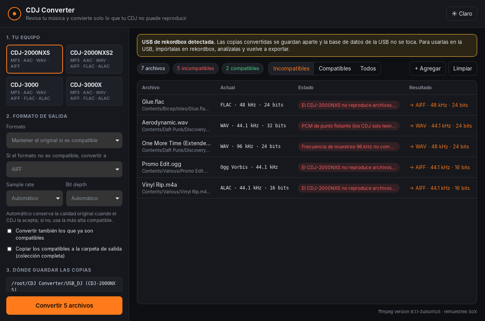

# CDJ Converter

Aplicación de escritorio para **Mac y Windows** que revisa tu música contra el CDJ que vas a usar
(CDJ-2000NXS, CDJ-2000NXS2, CDJ-3000 o CDJ-3000X) y crea **copias convertidas** solo de las
canciones que ese equipo no puede reproducir. Los originales nunca se modifican.



## Qué hace

- **Eliges tu CDJ** y arrastras canciones, carpetas o tu USB de rekordbox a la ventana.
- **Detecta automáticamente** qué archivos no son compatibles y por qué (formato, sample rate,
  bit depth, WAV de punto flotante, AAC que no es LC, más de 2 canales, extensión, etc.).
- **Tú decides la salida:** mantener el formato original cuando el CDJ lo acepta (por ejemplo,
  WAV → WAV pero a 48 kHz / 24 bits) o convertir todo a WAV, AIFF, FLAC, ALAC, MP3 o AAC, con el
  sample rate y bit depth que elijas. Solo se ofrecen opciones que el CDJ elegido acepta.
- **Conserva los metadatos:** título, artista, álbum, BPM, key, comentarios, género y portada.
  Entre MP3, WAV y AIFF se copia la etiqueta ID3 completa.
- **Copias, nunca sobrescribe:** guarda los archivos en otra carpeta (por defecto
  `Música/CDJ Converter/<nombre> (<modelo>)`) respetando la estructura de carpetas. Si un archivo
  ya existe, guarda la copia como `nombre (2).ext`.
- **Conversión en lote y en paralelo**, con progreso por archivo y opción de cancelar.
- Opción para **copiar también los compatibles** y tener la colección completa en un solo lugar.
- Modo oscuro (y claro), interfaz en español.

## Compatibilidad por modelo

| Formato | CDJ-2000NXS | CDJ-2000NXS2 ¹ | CDJ-3000 | CDJ-3000X ¹ |
|---|---|---|---|---|
| MP3 | 32–48 kHz (MPEG-1), 16–24 kHz (MPEG-2) | igual que NXS | 44.1 / 48 kHz | igual que 3000 |
| AAC (LC) | 16–48 kHz | igual que NXS | 44.1 / 48 kHz | igual que 3000 |
| WAV / AIFF | 16 / 24 bits, 44.1 / 48 kHz | 16 / 24 bits, hasta 96 kHz | 16 / 24 bits, hasta 96 kHz | igual que 3000 |
| FLAC / ALAC | ✕ | 16 / 24 bits, hasta 96 kHz | 16 / 24 bits, hasta 96 kHz | igual que 3000 |

Los datos del CDJ-2000NXS y del CDJ-3000 salen de la sección de formatos reproducibles de sus
manuales. ¹ No se adjuntaron los manuales del NXS2 ni del 3000X: el NXS2 usa las
especificaciones publicadas por Pioneer DJ y el 3000X se asume igual al 3000. Conviene
verificarlos; cada perfil es un JSON en [`crates/cdj-core/profiles/`](crates/cdj-core/profiles).

## USB de rekordbox

Si la carpeta que agregas tiene una carpeta `PIONEER`, la app avisa que es una USB de
rekordbox. Las copias convertidas se guardan aparte y **la base de datos de la USB no se toca**.
Para usarlas en la USB, impórtalas en rekordbox, analízalas y vuelve a exportar. Editar
directamente la base de datos de rekordbox queda para una segunda fase.

## Calidad de la conversión

- Motor: **FFmpeg**, incluido dentro de la app (no hay que instalar nada).
- Remuestreo con **SoX (libsoxr)** a máxima precisión y **dither triangular** al bajar de bits.
- En modo automático se conserva la calidad original si el CDJ la acepta; si no, se usa la más
  alta compatible de la misma familia (por ejemplo 96 kHz → 48 kHz y 88.2 / 176.4 kHz → 44.1 kHz
  en el NXS) para que el remuestreo sea lo más limpio posible.
- Los WAV de 24 bits se escriben con cabecera PCM clásica (no `WAVE_FORMAT_EXTENSIBLE`), que es
  la que leen todos los CDJ.
- La app avisa cuando pasar de un formato con pérdida a uno sin pérdida no recupera calidad.

## Descargar e instalar

Los instaladores se generan automáticamente con GitHub Actions (pestaña **Actions** →
**Instaladores** → artifacts de la última ejecución, o en **Releases** cuando se publica una
versión):

- **Mac:** `CDJ Converter_x.y.z_universal.dmg` (Intel y Apple Silicon, macOS 11 o superior).
  Como la app no está firmada con un certificado de Apple, la primera vez abre el menú con clic
  derecho → **Abrir**. Si macOS dice que está dañada, en Terminal:
  `xattr -cr "/Applications/CDJ Converter.app"`.
- **Windows:** `CDJ Converter_x.y.z_x64-setup.exe`. Si aparece SmartScreen, pulsa
  **Más información → Ejecutar de todas formas**.

Para publicar una versión: crea una etiqueta `v0.1.0` y súbela; se genera un borrador de release
con los dos instaladores.

## Desarrollo

Requisitos: [Rust](https://rustup.rs), Node.js 22 y los
[requisitos de Tauri](https://v2.tauri.app/start/prerequisites/) para tu sistema.

```bash
npm install
npm run fetch-ffmpeg          # descarga FFmpeg a src-tauri/binaries/
npm run tauri dev             # abre la app en modo desarrollo
npm run tauri build           # genera el instalador para tu sistema
cargo test -p cdj-core        # pruebas (las de conversión usan el ffmpeg del sistema)
```

### Estructura

```
crates/cdj-core/       Núcleo en Rust (sin interfaz, con pruebas)
  profiles/*.json      Reglas de compatibilidad de cada CDJ
  src/probe.rs         Lee formato, códec, sample rate, bits y bitrate de cada archivo
  src/analyze.rs       Compara cada archivo con el perfil del CDJ
  src/plan.rs          Decide qué convertir, a qué y dónde guardarlo
  src/ffmpeg.rs        Arma y ejecuta los comandos de FFmpeg
  src/metadata.rs      Copia etiquetas y portada
  src/scan.rs          Recorre carpetas y USB
  src/convert.rs       Ejecuta el lote en paralelo
src-tauri/             App de escritorio (Tauri 2)
src/                   Interfaz (React + TypeScript)
scripts/fetch-ffmpeg.mjs  Descarga FFmpeg para cada plataforma
.github/workflows/     CI y generación de instaladores
```

Para agregar otro modelo de CDJ, crea un JSON en `crates/cdj-core/profiles/` y regístralo en
`crates/cdj-core/src/profile.rs`.

## FFmpeg

FFmpeg se incluye como programa aparte, con su propia licencia
(builds de [BtbN](https://github.com/BtbN/FFmpeg-Builds) en Windows y de
[Martin Riedl](https://ffmpeg.martin-riedl.de) en Mac).
